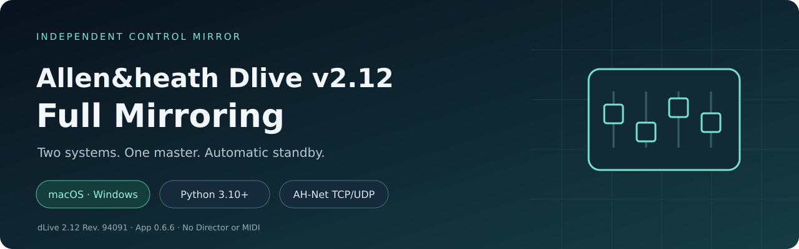

> [!CAUTION]
> Before connecting the application, load the same scene on both consoles. Mirror forwards subsequent changes; it does not automatically align the initial state.

# Allen&heath Dlive v2.12 Full Mirroring

Independent active/standby control mirroring for two dLive systems. Target firmware: dLive 2.12 Rev. 94091. Application build: 0.6.6. Python 3.10+; Windows and macOS; no third-party Python runtime packages required.

[English PDF](docs/USER_GUIDE_EN.pdf) · [Full English guide](docs/USER_GUIDE_EN.md) · [Features](docs/FEATURES_EN.md) · [Troubleshooting](docs/TROUBLESHOOTING_EN.md) · [Русский](README.md)

Each Surface stays connected to its own MixRack through gigaACE. The computer connects through Network Control and opens four logical sessions: two MixRacks and two Surfaces. Choose one initial direction. A fully ready surviving system becomes master if the active system fails, records new changes and replays them when the other returns. Returning hardware does not reclaim the master role.

Implemented: named-object parameter mapping, fixed 2857-object catalogue, fader/Mute forwarding, Global Tempo/Tap, Surface strip-position changes, echo suppression, reconnect, offline absolute-value compaction, batched replay and automatic log cleanup.

48V remains local. Scene/Show Store transfer, complete state cloning at startup, audio switching and old-queue continuation after a process restart are not implemented. Unknown data may block replay when session addresses cannot be safely mapped.

The application supports Russian and English. Use the Language selector in the header; the choice is saved in this browser. It can be changed while connected without altering device addresses or forwarding. Downloaded .command launchers may require the specific-file Gatekeeper approval explained below.

## Complete installation

All installation steps are included here. You do not need to open a separate installation document or follow an installation button. The application uses the Python standard library; no pip installation is required for normal operation.

### Installing on Windows

#### Install Python and extract the application

1. Open https://www.python.org/downloads/windows/ and install CPython 3.10 or newer. If using a traditional installer, enable its option to add Python to PATH and choose Install Now. If using Python Install Manager, open PowerShell after installing the manager and install a runtime, for example with py install 3.12.
2. Wait for installation to finish, open a new PowerShell window and check:

~~~powershell
py -3 --version
~~~

If py is unavailable, try python --version. It must report Python 3.10 or newer. If neither command works, reopen PowerShell and resolve Python installation before continuing.

3. Extract the complete application archive into a writable folder, for example C:\DliveMirror. Do not start the .bat launcher from an archive viewer.
4. Keep every supplied .py and JSON file beside the main program. Do not install additional packages with pip just to run Mirror.

#### Configure the two Ethernet interfaces

Connect the first Ethernet interface to system 1 Network Control and the second to system 2. For this example:

| Interface | IPv4 address | Subnet mask | Gateway/DNS on an isolated link |
|---|---|---|---|
| Ethernet 1 | 192.168.1.200 | 255.255.255.0 | Normally not set |
| Ethernet 2 | 192.168.2.200 | 255.255.255.0 | Normally not set |

Open Settings → Network & internet → Ethernet → the relevant interface → IP assignment → Edit → Manual → IPv4. Enter the address and subnet mask. Some Windows versions ask for prefix length 24 instead of the equivalent mask. Menu names may vary between releases.

Make sure you are changing the adapter connected to the correct system. Computer network settings do not change the console's address.

Check the interfaces and all four devices:

~~~powershell
ipconfig
ping 192.168.1.70
ping 192.168.1.71
ping 192.168.2.70
ping 192.168.2.71
Test-NetConnection 192.168.1.70 -Port 51321
Test-NetConnection 192.168.1.71 -Port 51321
Test-NetConnection 192.168.2.70 -Port 51321
Test-NetConnection 192.168.2.71 -Port 51321
~~~

Test-NetConnection checks TCP only, not UDP or a complete AH-Net session. ICMP may be filtered, so a failed ping alone is not always an application failure. The required device addresses and services must nevertheless be reachable.

If Windows Firewall requests permission, allow the selected Python executable on the trusted equipment-control network. Do not disable the firewall globally. Mirror needs device TCP/UDP traffic and incoming UDP replies on a dynamically assigned local port. The browser interface listens only on 127.0.0.1.

#### Launch and connect

Double-click Allen_heath_Dlive_v2.12_Full_Mirroring_Windows.bat. Keep its window open. The browser should open automatically.

Alternatively, run:

~~~powershell
cd C:\DliveMirror
py -3 allen_heath_dlive_full_mirroring.py
~~~

If your installation provides only python:

~~~powershell
python allen_heath_dlive_full_mirroring.py
~~~

Open http://127.0.0.1:8780 if the browser does not open; use the actual address printed in the command window if you changed the port.

In the Computer IP → A/B fields, enter this Windows computer's local addresses: 192.168.1.200 and 192.168.2.200 for this example.

Select the Surface/MixRack models, enter all device addresses, choose the initial direction, click Connect Both, wait until both systems are ready, and then start forwarding. The current UI labels are explained in section 5.

#### Windows launch problems

| Symptom | Check |
|---|---|
| py/python is not found | Reopen PowerShell after installation; check the installed runtime and PATH |
| Running python opens the Store | No suitable runtime is installed, or app execution aliases take precedence |
| Launcher closes unexpectedly | Run directly in PowerShell to read the error; check Python version and all supplied files |
| WinError 10049 | The local address is not assigned to an active interface |
| TCP works but subscription does not | Check UDP, firewall, firmware, Surface address and device startup |
| Address already in use | Use another --ui-port or stop the previous instance |
| Failed to fetch | Confirm Python is still running and the browser uses the current local URL |

Do not close the launcher during mirroring. At the end, wait for an empty queue, export any needed diagnostics, then click Disconnect Both. This deletes application logs and any unfinished queued commands directly.

### Installing on macOS

#### Install Python and extract the application

1. Open https://www.python.org/downloads/macos/, choose CPython 3.10 or newer and download its macOS .pkg installer.
2. Double-click the .pkg, proceed through Continue, accept the terms, choose Install and enter your password if requested. Wait for completion. Official universal2 installers cover supported Apple Silicon and Intel Macs; check the OS support for the selected release.
3. Open Terminal and check:

~~~sh
python3 --version
~~~

An old system python3 is not necessarily suitable. Do not delete or replace Apple-managed Python files. A python.org installation is separate.

4. Extract the full application archive into a writable folder, such as Downloads or Documents. Do not run it inside the ZIP.
5. Keep all files together. No additional pip packages are required.

#### Configure the two Ethernet connections

Connect the first adapter to system 1 Network Control and the second to system 2. Open System Settings → Network → the relevant Ethernet/USB adapter → Details → TCP/IP → Configure IPv4 → Manually.

| Interface | IPv4 address | Subnet mask | Router/DNS |
|---|---|---|---|
| Ethernet 1 | 192.168.1.200 | 255.255.255.0 | Normally unnecessary for an isolated link |
| Ethernet 2 | 192.168.2.200 | 255.255.255.0 | Normally unnecessary for an isolated link |

Use your actual equipment addressing. Renaming a network service does not assign an IP address. Check with:

~~~sh
ifconfig
ping -c 3 192.168.1.70
ping -c 3 192.168.1.71
ping -c 3 192.168.2.70
ping -c 3 192.168.2.71
nc -vz 192.168.1.70 51321
nc -vz 192.168.1.71 51321
nc -vz 192.168.2.70 51321
nc -vz 192.168.2.71 51321
~~~

nc checks only TCP. Mirror also needs UDP and AH-Net registration. One reachable MixRack is not sufficient to prove readiness of its Surface + MixRack pair.

#### First launch and Gatekeeper

The current distribution is Python source with a .command launcher. It is not a Developer ID-signed, Apple-notarized .app. Installing official Python does not sign the Mirror launcher.

1. Confirm that the complete archive came from a trusted source and has been extracted.
2. In Finder, double-click Allen_heath_Dlive_v2.12_Full_Mirroring.command.
3. If macOS says the developer cannot be verified or Apple cannot check the file, dismiss that warning.
4. Open Apple menu → System Settings → Privacy & Security.
5. Scroll to Security and locate the blocked Mirror file.
6. Choose Open Anyway. The precise wording varies by language and OS version.
7. Authenticate with your password or Touch ID if requested, then click Open in the repeated prompt.
8. Terminal and the local browser page should open. If not, use the URL printed in Terminal, normally http://127.0.0.1:8780.

This is an exception for that particular file. Later launches of the same copy normally work by double-clicking. A new download or updated copy may request approval again.

If Open Anyway is absent, try opening the .command file in Finder again, then return to Privacy & Security. The message appears after a launch attempt. On an organization-managed Mac, policy may prevent adding this exception; contact the administrator.

An unknown-developer message is different from an explicit malware or damaged-file alert. Do not automatically apply the same exception procedure to those alerts; check the source and download. Global Gatekeeper disabling is not required. Apple's procedure is documented at https://support.apple.com/en-us/102445.

#### If execute permission is missing

Open Terminal in the application folder and run:

~~~sh
chmod +x Allen_heath_Dlive_v2.12_Full_Mirroring.command
./Allen_heath_Dlive_v2.12_Full_Mirroring.command
~~~

chmod +x grants execute permission to this specific file. It is not an Apple signature or notarization and does not replace Gatekeeper approval.

If macOS asks for local-network access, grant it to the relevant process where that setting is available. Do not disable system security globally.

#### Direct launch from Terminal

Type cd followed by a space, drag the extracted application folder into Terminal and press Return. Then run:

~~~sh
python3 allen_heath_dlive_full_mirroring.py
~~~

If the browser does not open, use the printed URL. Fill in device models and addresses, select the initial master, connect, wait for readiness and start forwarding. Keep Terminal open.

#### Sleep, power and macOS problems

The computer and network adapters must remain active. Sleep or closing Python interrupts control. This is not autonomous redundancy without the computer.

| Error | Check |
|---|---|
| Unknown developer / Apple cannot verify | Follow the first-launch procedure for the specific .command file |
| Open Anyway is missing | Retry launching in Finder; check organizational restrictions |
| Permission denied | Restore execute permission or launch the main Python file directly |
| Can't assign requested address / Errno 49 | The local IP is missing or its interface is inactive |
| Connection refused | Check address, port and device startup; transient Surface UDP refusal is retried without destroying live TCP |
| Module not found | Keep all supplied files together and start the main program |
| Browser cannot reach Mirror | Check the running Python process and local port |

For a normal shutdown, wait for an empty queue, export any needed diagnostics, click Disconnect Both and close the process. That button deletes logs and unfinished commands without moving them to Trash.

## Daily operation and limits

After connecting, wait until both complete systems are ready and start forwarding. Keep the Terminal/command window open. Test actual destination values; ping and ACK do not prove full readiness.

After failure, the surviving system remains master even when the old master returns. The queue is limited to 250000 unfinished records or 128 MiB. Replay uses up to 32 commands / 32 KiB per batch with a 1000 commands/s rate limit. Only proven absolute input-fader/Mute repeats are compacted between other actions.

When both systems are ready and every unfinished queue is drained, disk logs are deleted directly. Healthy operation keeps the event history and working queue in memory; another outage resumes disk logging. Disconnect Both also deletes unfinished queued commands. Export diagnostics first if they are needed.

Supported selections: S7000/S5000/S3000/C3500/C2500/C1500/CTi1500 and DM32/48/64 or CDM32/48/64. Physical operation was confirmed by the user on S5000 + DM64 and C3500 + DM64; model selection is not separate hardware certification.

## Development and distribution

Run python3 tools/run_tests.py and python3 tools/check_package.py, or use py -3 on Windows. Build the compact runtime ZIP with tools/build_release.py. Documentation PDF generation needs separate documentation-only dependencies; they are not needed by the app.

No open-source license has been selected by the owner. See LICENSE_STATUS.md before redistribution. This independent project does not claim manufacturer endorsement.
