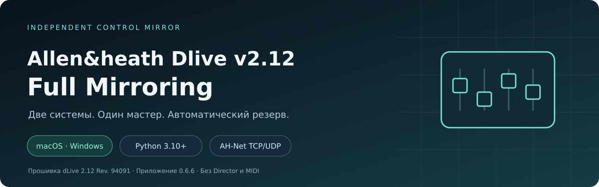
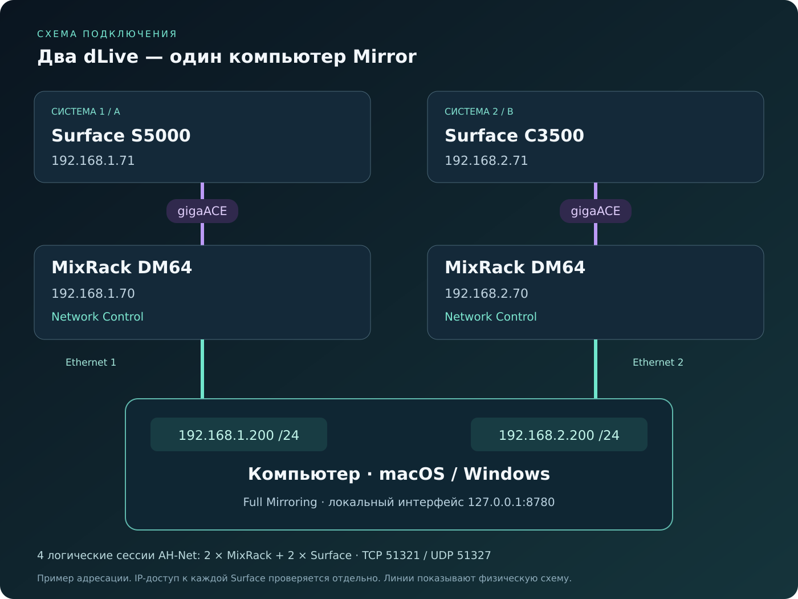
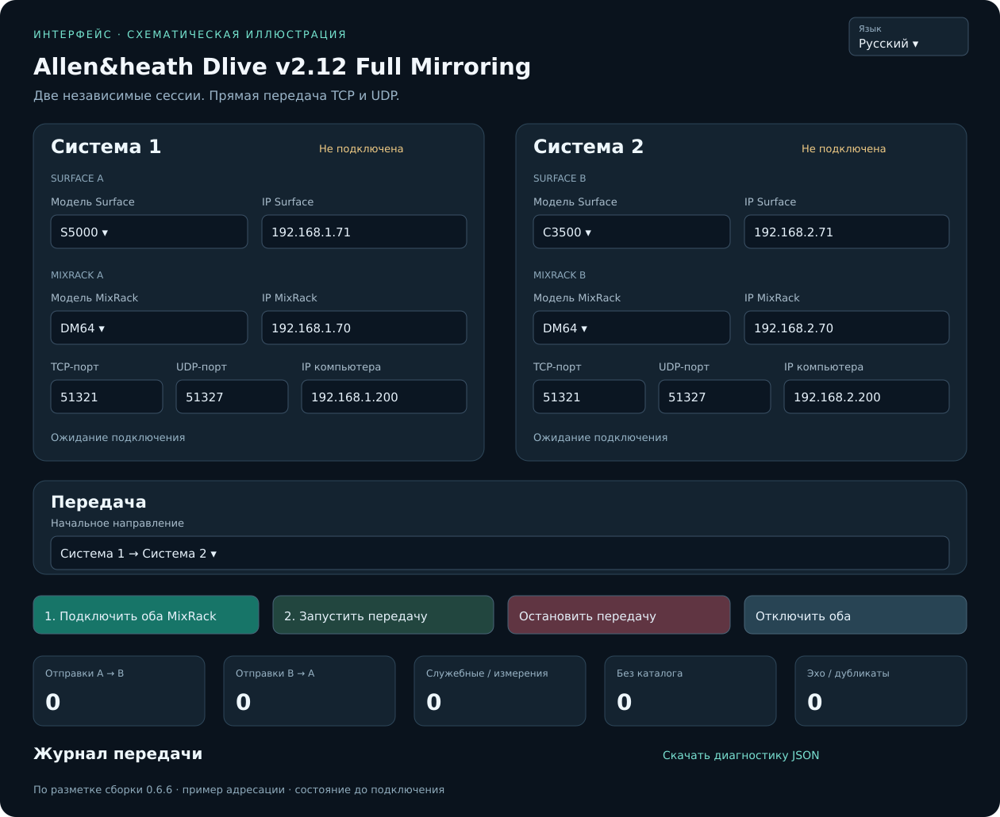

> [!CAUTION]
> Перед подключением приложения загрузите одну и ту же сцену на оба пульта. Mirror передаёт последующие изменения и не выравнивает исходное состояние автоматически.

<b>Параметры · Strip Assign · Global Tempo · Автоматический резерв</b> macOS и Windows · Python 3.10+ · AH-Net TCP/UDP · сборка 0.6.6

# Allen&heath Dlive v2.12 Full Mirroring

Независимое приложение для передачи изменений между двумя системами Allen & Heath dLive. Каждая Surface работает со своим MixRack, а компьютер подключается к обеим системам через Network Control. Director, MIDI и облачный сервис для работы Mirror не нужны.

**Режим работы:** один текущий мастер и одна резервная система. Начальное направление выбирается как 1 → 2 или 2 → 1; при отказе ведущей системы управление автоматически переходит к исправной.

> Название v2.12 обозначает целевую прошивку dLive 2.12 Rev. 94091. Версия самого приложения — 0.6.6. Это независимый проект; официальная поддержка Allen & Heath не заявляется.

[PDF-инструкция](docs/USER_GUIDE_RU.pdf) · [Подробная инструкция](docs/USER_GUIDE_RU.md) · [Возможности](docs/FEATURES_RU.md) · [Устранение ошибок](docs/TROUBLESHOOTING_RU.md) · [English](README.en.md)

## Подключение

Фиолетовые линии — gigaACE между Surface и её MixRack. Зелёные — физические подключения компьютера к Network Control каждой системы. Программа открывает четыре логические сессии: две к MixRack и две к Surface. Доступность Surface по IP через выбранную сеть нужно проверить отдельно.

## Возможности

| Функция | Поведение |
|---|---|
| Параметры MixRack | Именованное сопоставление объектов и преобразование уведомлений в записи |
| Максимальная подписка | Фиксированный каталог 2857 объектов, включая Global Tempo |
| Фейдеры и Mute | Передача с подавлением эха; сокращение повторных значений при восстановлении |
| DSP, маршрутизация и FX | Передача свойств подписанных объектов; подробный охват и ограничения в инструкции |
| Global Tempo / Tap | Прямая передача периода; опрос мастера примерно каждые 250 мс |
| Strip Assign | Передача изменений позиций внутри слоёв с учётом геометрии банков |
| Резервирование | Контроль Surface и MixRack, смена мастера, запись очереди, автоподключение |
| Восстановление | Свежие адреса объектов, приоритетная подписка, пакетная отправка очереди |
| Диск и логи | Очистка после полного восстановления; при исправной связи журнал в памяти |
| Диагностика | JSON, текущий журнал и доступный дисковый трафик JSONL |

Все рабочие опции включены постоянно. Галочки, выбор профиля и одновременное направление 1 ⇄ 2 в пользовательском интерфейсе отсутствуют.

## Установка

В приложении есть переключатель «Язык / Language»: Русский и English. Выбор сохраняется в браузере; менять язык можно во время передачи.

Все действия приведены здесь полностью. Открывать отдельные файлы инструкции или нажимать кнопки перехода для установки не требуется. Нужен Python 3.10+; дополнительные пакеты через pip для запуска не нужны.

### Установка в Windows

#### Python и файлы

1. Откройте https://www.python.org/downloads/windows/ и установите CPython 3.10 или новее. Если выбран классический установщик, запустите его, включите добавление Python в PATH и выполните Install Now. Если установлен Python Install Manager, откройте PowerShell и установите runtime командой py install 3.12 (3.12 — пример совместимой версии). Дождитесь окончания установки.
2. Откройте новое окно PowerShell и проверьте команду:

~~~powershell
py -3 --version
~~~

Если py отсутствует, проверьте python --version. Версия должна быть 3.10 или новее. Если обе команды не работают, перезапустите PowerShell и проверьте установку Python; дальнейший запуск приложения пока невозможен.

3. Распакуйте рабочий архив, например в C:\DliveMirror. Не запускайте .bat из окна архиватора. Папка должна быть доступна текущему пользователю для записи.
4. Сохраните все файлы приложения рядом друг с другом. pip install для запуска не требуется.

#### Два сетевых интерфейса

Подключите Ethernet 1 к Network Control первой системы, Ethernet 2 — ко второй. Для примера из руководства:

| Интерфейс | IPv4 | Маска | Шлюз/DNS для изолированной линии |
|---|---|---|---|
| Ethernet 1 | 192.168.1.200 | 255.255.255.0 | Не задаются без необходимости схемы |
| Ethernet 2 | 192.168.2.200 | 255.255.255.0 | Не задаются без необходимости схемы |

В Windows откройте Параметры → Сеть и Интернет → Ethernet → нужный интерфейс → Назначение IP → Изменить → Вручную → IPv4. Введите адрес и маску; в некоторых версиях Windows вместо маски используется длина префикса 24. Названия разделов зависят от выпуска Windows.

Убедитесь, что меняете именно тот адаптер, кабель которого идёт к соответствующей системе. Настройки компьютера не изменяют IP пульта.

Проверка:

~~~powershell
ipconfig
ping 192.168.1.70
ping 192.168.1.71
ping 192.168.2.70
ping 192.168.2.71
Test-NetConnection 192.168.1.70 -Port 51321
Test-NetConnection 192.168.1.71 -Port 51321
Test-NetConnection 192.168.2.70 -Port 51321
Test-NetConnection 192.168.2.71 -Port 51321
~~~

Test-NetConnection проверяет TCP, не полноценную AH-Net-сессию и не UDP. Отсутствие ping не всегда означает отказ приложения: ICMP может быть отфильтрован. Но до запуска всё оборудование должно быть доступно по нужным адресам и портам.

Если Windows показывает запрос брандмауэра, разрешите используемому Python работу в доверенной сети управления. Не отключайте брандмауэр целиком. Нужны TCP/UDP-обмен с устройствами и приём ответов UDP на локальный динамический порт. Интерфейс браузера использует только 127.0.0.1.

#### Запуск

Дважды щёлкните Allen_heath_Dlive_v2.12_Full_Mirroring_Windows.bat. Окно останется открытым, а браузер откроет локальный интерфейс.

Или в PowerShell:

~~~powershell
cd C:\DliveMirror
py -3 allen_heath_dlive_full_mirroring.py
~~~

Если работает только python:

~~~powershell
python allen_heath_dlive_full_mirroring.py
~~~

В поле «IP компьютера → A/B» введите локальные адреса Windows-компьютера — 192.168.1.200 и 192.168.2.200 для этого примера.

Выберите модели, заполните IP Surface/MixRack, оставьте стандартные порты при обычной схеме, выберите начальное направление. Нажмите подключение, дождитесь готовности, затем запуск передачи.

#### Завершение и типовые проблемы

Не закрывайте окно .bat во время зеркалирования. Для планового завершения дождитесь пустой очереди, скачайте нужную диагностику и нажмите «Отключить оба»: все логи и незавершённые команды удаляются напрямую.

| Симптом | Проверка |
|---|---|
| py/python не найден | Откройте новое окно после установки; проверьте официальный способ установки и PATH |
| Вместо Python открывается магазин | Python runtime не установлен либо мешают execution aliases |
| Окно сразу закрывается | Запустите из PowerShell и прочитайте ошибку; проверьте наличие всех модулей и Python 3.10+ |
| WinError 10049 | Введённый локальный адрес не назначен адаптеру или адаптер отключён |
| TCP проходит, подписка нет | Проверьте UDP, брандмауэр, прошивку, адрес Surface и завершение загрузки оборудования |
| Address already in use | Укажите другой --ui-port либо завершите предыдущий экземпляр |
| Failed to fetch | Проверьте, что процесс Python жив и браузер открыт на текущем адресе |

### Установка в macOS

#### Python и файлы

1. Откройте https://www.python.org/downloads/macos/, выберите выпуск CPython 3.10 или новее и скачайте установщик macOS .pkg. Откройте .pkg двойным щелчком, пройдите «Продолжить» → согласие с условиями → «Установить», подтвердите установку паролем, если он запрошен, и дождитесь завершения. Официальные universal2-сборки предназначены для поддерживаемых Apple Silicon и Intel Mac; совместимость конкретного выпуска проверяется на странице Python.
2. Откройте Terminal и проверьте:

~~~sh
python3 --version
~~~

Наличие старого системного python3 не гарантирует подходящую версию. Не удаляйте и не заменяйте файлы системного Python Apple. Установка собственного Python с python.org выполняется отдельно.

3. Распакуйте приложение в доступную для записи папку, например Downloads или Documents. Не запускайте исходники прямо из ZIP.
4. Дополнительные библиотеки через pip не нужны.

#### Настройка двух Ethernet-подключений

Первый адаптер соедините с Network Control системы 1, второй — с системой 2. В macOS откройте Системные настройки → Сеть → нужный Ethernet/USB-адаптер → Подробнее → TCP/IP → Настроить IPv4 вручную.

| Интерфейс | IPv4 | Маска | Маршрутизатор/DNS |
|---|---|---|---|
| Первый Ethernet | 192.168.1.200 | 255.255.255.0 | Для изолированной линии обычно не нужны |
| Второй Ethernet | 192.168.2.200 | 255.255.255.0 | Для изолированной линии обычно не нужны |

Укажите настройки, соответствующие реальным адресам оборудования. Для другой сетевой схемы таблицу нужно изменить. Переименование сетевых служб для удобства допустимо, но само по себе не задаёт IP.

Для проверки используйте:

~~~sh
ifconfig
ping -c 3 192.168.1.70
ping -c 3 192.168.1.71
ping -c 3 192.168.2.70
ping -c 3 192.168.2.71
nc -vz 192.168.1.70 51321
nc -vz 192.168.1.71 51321
nc -vz 192.168.2.70 51321
nc -vz 192.168.2.71 51321
~~~

nc проверяет только TCP-порт. Mirror дополнительно использует UDP и регистрацию AH-Net. Ответ одного MixRack не подтверждает готовность всей системы Surface + MixRack.

#### Запуск через Finder

Первый запуск скачанного файла может блокироваться защитой Gatekeeper. Текущая поставка содержит Python-код и файл .command; это не подписанное и нотарифицированное Apple приложение .app. Установка официального Python не подписывает автоматически файл запуска Mirror.

##### Первый запуск: разрешение Gatekeeper

1. Установите Python и распакуйте весь комплект, как описано выше. Проверьте, что архив получен из доверенного источника.
2. В Finder откройте папку приложения и дважды щёлкните Allen_heath_Dlive_v2.12_Full_Mirroring.command.
3. Если macOS сообщает, что разработчик неизвестен или Apple не может проверить файл, закройте это предупреждение. Пока программа может не запуститься.
4. Откройте меню Apple → «Системные настройки» → «Конфиденциальность и безопасность».
5. Прокрутите до раздела «Безопасность» и найдите сообщение о блокировке именно файла Mirror.
6. Нажмите «Все равно открыть» / «Открыть в любом случае» (Open Anyway). Название кнопки зависит от версии и языка macOS.
7. Подтвердите действие паролем или Touch ID, если система запросит, затем нажмите «Открыть» в повторном предупреждении.
8. Должны открыться Terminal и локальная страница Mirror. Если браузер не открылся, используйте адрес из Terminal, обычно http://127.0.0.1:8780.

Разрешение относится к выбранному файлу. Последующие запуски этой копии обычно выполняются двойным щелчком. После загрузки обновления или другой копии подтверждение может понадобиться снова.

##### Если кнопки разрешения нет

Сначала ещё раз попробуйте открыть .command в Finder, затем вернитесь в настройки: сообщение появляется после попытки запуска. Проверьте, что разрешаете именно нужный файл. На управляемом организацией Mac исключение может быть недоступно — обратитесь к администратору.

Предупреждение о неизвестном разработчике отличается от сообщения об обнаруженном вредоносном ПО или повреждении файла. Во втором случае не используйте эту процедуру автоматически: проверьте источник и загрузку.

Глобально отключать Gatekeeper или разрешать все приложения для работы Mirror не требуется. Официальное описание процедуры Apple: https://support.apple.com/ru-ru/102445.

##### Если потерялось право на выполнение

Если после копирования потерялось разрешение на выполнение, откройте Terminal в папке приложения и выполните:

~~~sh
chmod +x Allen_heath_Dlive_v2.12_Full_Mirroring.command
./Allen_heath_Dlive_v2.12_Full_Mirroring.command
~~~

chmod +x задаёт право выполнения конкретного файла и не является подписью или подтверждением Apple. Это исправление Permission denied, а не замена процедуры Gatekeeper выше.

При запросе разрешений macOS разрешите программе доступ к локальной сети, если такая настройка доступна в вашей версии ОС. Не отключайте системные защиты целиком.

#### Запуск напрямую из Terminal

В Terminal наберите cd и пробел, перетащите распакованную папку приложения в окно и нажмите Return. Затем:

~~~sh
python3 allen_heath_dlive_full_mirroring.py
~~~

Если браузер не открылся, введите напечатанный адрес вручную, обычно http://127.0.0.1:8780. Программа не поставляется как подписанное .app; запуск через Python — штатный способ.

Введите все адреса и модели, выберите начального мастера, нажмите подключение и дождитесь готовности обеих систем. Затем включите передачу. Terminal должен оставаться открытым.

#### Сон, питание и завершение

Компьютер должен оставаться включённым, сетевые адаптеры — активными. Сон компьютера, выключение адаптера и закрытие процесса Python прерывают управление. Это не механизм автономного резервирования без компьютера.

Для завершения дождитесь пустой очереди, скачайте нужную диагностику, нажмите «Отключить оба», затем завершите процесс. Эта кнопка удаляет логи и незавершённые команды без корзины.

| Ошибка | Что проверить |
|---|---|
| Неизвестный разработчик / Apple не может проверить файл | Выполните первый запуск и разрешение для конкретного .command по процедуре выше |
| Кнопки «Все равно открыть» нет | Повторите попытку в Finder и откройте настройки; на управляемом Mac обратитесь к администратору |
| Permission denied у .command | Разрешение на выполнение; при необходимости запускайте Python напрямую |
| Can't assign requested address / Errno 49 | Локальный IP не назначен выбранному адаптеру либо адрес исчез при отключении |
| Connection refused | Адрес/порт и готовность службы пульта; временный отказ UDP теперь повторяется без закрытия живого TCP |
| Не найден модуль | Все файлы должны оставаться в одной папке; запускайте основной файл, не вспомогательные модули |
| Браузер не видит приложение | Процесс Python должен работать; проверьте порт и текущий URL |

Сначала проверяйте реальный адрес и маршрут, а затем параметры Mirror. Введение IP в поле программы не назначает его адаптеру macOS.

| Устройство | Система 1 | Система 2 |
|---|---|---|
| Surface | S5000 — 192.168.1.71 | C3500 — 192.168.2.71 |
| MixRack | DM64 — 192.168.1.70 | DM64 — 192.168.2.70 |
| Локальный IP компьютера | 192.168.1.200 | 192.168.2.200 |
| Маска в этом примере | 255.255.255.0 | 255.255.255.0 |

Это пример адресации, а не требование использовать именно эти адреса. Значения в полях компьютера уже должны существовать в сетевых настройках ОС.

Схематическая иллюстрация по разметке интерфейса сборки 0.6.6 до подключения; это не снимок аппаратной сессии.

## Как работает возврат после обрыва

1. Система 1 управляет системой 2.
2. При отказе Surface 1, MixRack 1 или обоих мастер переходит к системе 2, если она полностью готова.
3. Изменения на системе 2 сохраняются в очереди.
4. После возврата системы 1 Mirror автоматически подключается к ней и передаёт очередь.
5. Система 2 остаётся мастером. Возврат старого мастера не разворачивает направление обратно.
6. Когда обе системы готовы и незавершённых команд нет, логи удаляются напрямую, без корзины.

## Границы функциональности

- 48V не синхронизируется: фантомное питание остаётся локальным.
- Сохранение сцен и Show не переносится; развитие этого направления остановлено.
- При запуске нет полного копирования текущего состояния одного пульта в другой.
- Поток уровней и распознанные служебные сообщения не зеркалируются.
- Программа передаёт управление, а не аудио, и не переключает аудиотракт.
- Каталог фиксированный. «2857 объектов» не означает проверку каждого параметра каждой модели или каждой версии прошивки.
- Неизвестные данные сохраняют существующие правила передачи. После смены сессии непрозрачная команда может остановить восстановление, если её адреса невозможно сопоставить.
- Отправка в сокет не равна подтверждению применения прошивкой; возможны повторные записи состояния при разрыве в момент отправки.
- Продолжение очереди после перезапуска процесса не реализовано.
- «Отключить оба» удаляет также незавершённую очередь. Скачайте нужную диагностику до нажатия этой кнопки.

## Модели и платформы

Surface в меню: S7000, S5000, S3000, C3500, C2500, C1500, CTi1500. MixRack: DM32, DM48, DM64, CDM32, CDM48, CDM64.

Пользователь подтвердил работу на S5000 + DM64 и C3500 + DM64 с прошивкой 2.12 Rev. 94091. Наличие остальных моделей в меню не является отдельной аппаратной сертификацией. Python-приложение использует стандартную библиотеку; установок через pip для запуска не требуется. Нативные .app/.exe-инсталляторы в поставку не входят.

## Разработка и тесты

~~~sh
python3 tools/run_tests.py
python3 tools/check_package.py
python3 tools/build_release.py
~~~

На Windows используйте `py -3` вместо `python3`. Проверки используют имитаторы на loopback, а не подключённое оборудование. GitHub Actions подготовлен для Windows, macOS и Linux; результаты CI появятся после загрузки репозитория.

История: [CHANGELOG](CHANGELOG.md). Сборка релиза: [описание](docs/GITHUB_PUBLISH_RU.md). Вопросы и исправления: [CONTRIBUTING](CONTRIBUTING.md).

## Публикация и лицензия

Полная английская документация: README.en.md и docs/USER_GUIDE_EN.md; PDF — docs/USER_GUIDE_EN.pdf. В английском README установка обеих ОС также приведена полностью.

Этот пакет подготовлен к загрузке, но автоматически на GitHub не опубликован. Имя репозитория и аккаунт не привязаны.

Открытая лицензия владельцем пока не выбрана. Перед распространением определите условия использования и добавьте соответствующий LICENSE. Приложение, названия и документация не заявляют связи с производителем. [Примечание о лицензии](LICENSE_STATUS.md).
