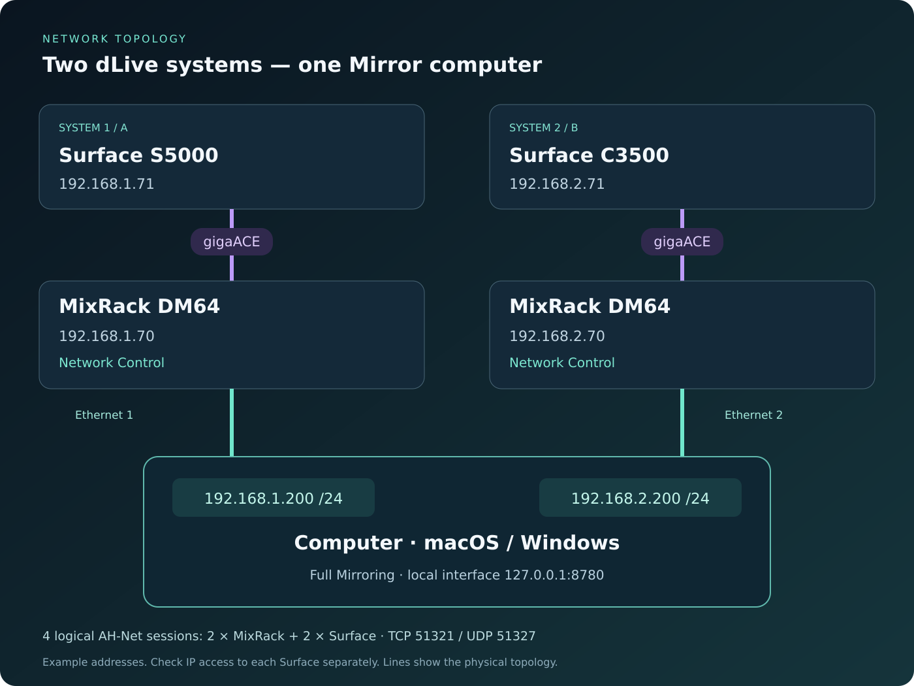
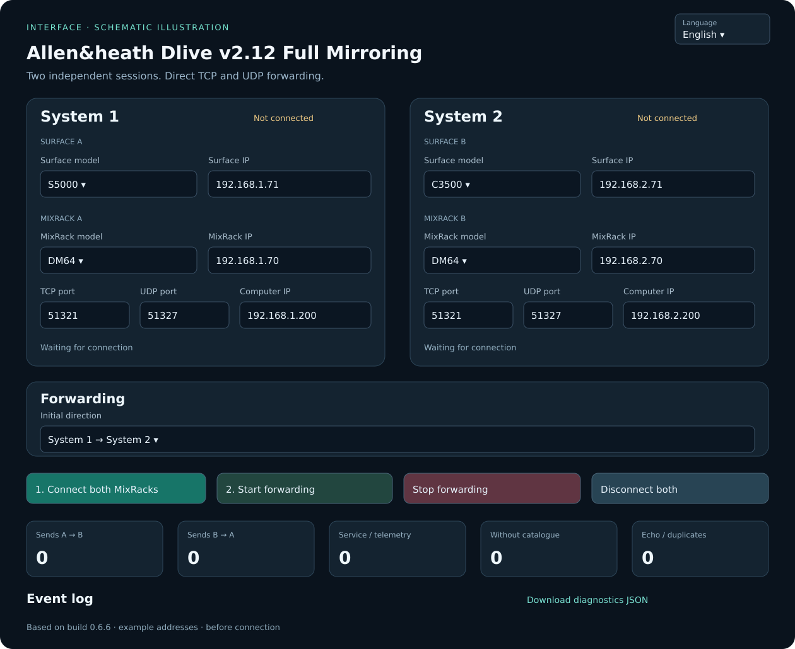

# User guide
## Allen&heath Dlive v2.12 Full Mirroring

Application build 0.6.6. Target firmware: dLive 2.12 Rev. 94091. One Windows or macOS computer controls two independent Surface + MixRack systems. This is an independent project; manufacturer endorsement is not claimed.

> [!CAUTION]
> **IMPORTANT: Before connecting the application, load the same scene on both consoles.** Mirror forwards subsequent changes; it does not automatically align the initial state. If I/O differs, verify port and assignment compatibility. Set 48V separately on each system.

## 1. Purpose and operation

Mirror receives changes from the current master and sends corresponding control writes to the second system. Known objects are matched by name, and destination addresses are resolved separately for each connection. Numeric addresses from a capture are not treated as permanent addresses for another session.

This is event-based control mirroring. There is no complete automatic state clone at startup. Prepare compatible initial configurations on both systems using normal dLive procedures before enabling mirroring. Differences in physical I/O, channel assignments and rack configuration must be considered in advance.

Each Surface remains connected to its own MixRack. Mirror does not carry audio over its TCP/UDP connections, replace gigaACE or automatically switch audio outputs when a system fails.

## 2. Requirements and package

You need two Surfaces, two MixRacks, a computer running CPython 3.10 or newer with sqlite3, and network access to all four device addresses. No third-party Python packages are required to run the application.

The example uses two Ethernet interfaces on the computer. Built-in ports, USB-C/Thunderbolt adapters or suitable network cards can be used. Entering two local addresses in Mirror does not create interfaces or assign addresses in the operating system. A single interface with extra addresses or VLANs requires a separately configured network; the guide uses two interfaces to make routing explicit.

Extract the entire package into a writable folder. The application saves connection.json and creates a logs folder during connection or an outage. Do not run the launcher from inside a ZIP archive. Keep the Terminal or command window open throughout operation.

| Component | Requirement |
|---|---|
| Python | CPython 3.10 or newer, including sqlite3 |
| Browser | A current browser with JavaScript enabled |
| Network | Access to both MixRacks and both Surfaces |
| Local addresses | Two OS-assigned IPv4 addresses for the example topology |
| Firmware | Primary target: dLive 2.12 Rev. 94091 |
| Distribution | Python sources with .command and .bat launchers; no standalone .app/.exe installer |
| Internet | Needed to obtain Python/files; not needed for local mirroring |

A precise minimum OS version or hardware-performance specification has not been measured. OS compatibility also depends on the selected Python release. Starting the program successfully is not a substitute for testing the actual console configuration.

## 3. Wiring and addressing

| Device | System 1 / A | System 2 / B |
|---|---|---|
| Surface | S5000 — 192.168.1.71 | C3500 — 192.168.2.71 |
| MixRack | DM64 — 192.168.1.70 | DM64 — 192.168.2.70 |
| Computer interface | 192.168.1.200 | 192.168.2.200 |
| Subnet mask | 255.255.255.0 | 255.255.255.0 |
| Device TCP / UDP ports | 51321 / 51327 | 51321 / 51327 |

These addresses are examples. Use addresses appropriate to your equipment. Each address must be unique on its network; the four Surface/MixRack addresses in the application configuration must be different.

1. Connect Surface 1 to MixRack 1 through gigaACE.
2. Connect Surface 2 to MixRack 2 through gigaACE.
3. Connect computer Ethernet 1 to the Network Control connection of system 1.
4. Connect computer Ethernet 2 to the Network Control connection of system 2.
5. Assign the computer addresses in Windows or macOS as explained below.
6. Check network access to every MixRack and every Surface independently.

Do not connect an ordinary computer Ethernet port to gigaACE as if it were the management-network connection. The chosen network must provide IP access to each Surface; an answer from its MixRack alone does not prove that the entire system is ready.

Gateways and DNS are normally unnecessary on isolated direct-control links. If your network contains routers or other infrastructure, use its actual addressing and routing plan.

## 4. Complete installation

> [!CAUTION]
> **Before connecting: load identical scenes on both consoles.** Only then connect Mirror and start forwarding.

All installation steps are included here. You do not need to open a separate installation document or follow an installation button. The application uses the Python standard library; no pip installation is required for normal operation.

### Installing on Windows

#### Install Python and extract the application

1. Open https://www.python.org/downloads/windows/ and install CPython 3.10 or newer. If using a traditional installer, enable its option to add Python to PATH and choose Install Now. If using Python Install Manager, open PowerShell after installing the manager and install a runtime, for example with py install 3.12.
2. Wait for installation to finish, open a new PowerShell window and check:

~~~powershell
py -3 --version
~~~

If py is unavailable, try python --version. It must report Python 3.10 or newer. If neither command works, reopen PowerShell and resolve Python installation before continuing.

3. Extract the complete application archive into a writable folder, for example C:\DliveMirror. Do not start the .bat launcher from an archive viewer.
4. Keep every supplied .py and JSON file beside the main program. Do not install additional packages with pip just to run Mirror.

#### Configure the two Ethernet interfaces

Connect the first Ethernet interface to system 1 Network Control and the second to system 2. For this example:

| Interface | IPv4 address | Subnet mask | Gateway/DNS on an isolated link |
|---|---|---|---|
| Ethernet 1 | 192.168.1.200 | 255.255.255.0 | Normally not set |
| Ethernet 2 | 192.168.2.200 | 255.255.255.0 | Normally not set |

Open Settings → Network & internet → Ethernet → the relevant interface → IP assignment → Edit → Manual → IPv4. Enter the address and subnet mask. Some Windows versions ask for prefix length 24 instead of the equivalent mask. Menu names may vary between releases.

Make sure you are changing the adapter connected to the correct system. Computer network settings do not change the console's address.

Check the interfaces and all four devices:

~~~powershell
ipconfig
ping 192.168.1.70
ping 192.168.1.71
ping 192.168.2.70
ping 192.168.2.71
Test-NetConnection 192.168.1.70 -Port 51321
Test-NetConnection 192.168.1.71 -Port 51321
Test-NetConnection 192.168.2.70 -Port 51321
Test-NetConnection 192.168.2.71 -Port 51321
~~~

Test-NetConnection checks TCP only, not UDP or a complete AH-Net session. ICMP may be filtered, so a failed ping alone is not always an application failure. The required device addresses and services must nevertheless be reachable.

If Windows Firewall requests permission, allow the selected Python executable on the trusted equipment-control network. Do not disable the firewall globally. Mirror needs device TCP/UDP traffic and incoming UDP replies on a dynamically assigned local port. The browser interface listens only on 127.0.0.1.

#### Launch and connect

Double-click Allen_heath_Dlive_v2.12_Full_Mirroring_Windows.bat. Keep its window open. The browser should open automatically.

Alternatively, run:

~~~powershell
cd C:\DliveMirror
py -3 allen_heath_dlive_full_mirroring.py
~~~

If your installation provides only python:

~~~powershell
python allen_heath_dlive_full_mirroring.py
~~~

Open http://127.0.0.1:8780 if the browser does not open; use the actual address printed in the command window if you changed the port.

In the Computer IP → A/B fields, enter this Windows computer's local addresses: 192.168.1.200 and 192.168.2.200 for this example.

Select the Surface/MixRack models, enter all device addresses, choose the initial direction, click Connect Both, wait until both systems are ready, and then start forwarding. The current UI labels are explained in section 5.

#### Windows launch problems

| Symptom | Check |
|---|---|
| py/python is not found | Reopen PowerShell after installation; check the installed runtime and PATH |
| Running python opens the Store | No suitable runtime is installed, or app execution aliases take precedence |
| Launcher closes unexpectedly | Run directly in PowerShell to read the error; check Python version and all supplied files |
| WinError 10049 | The local address is not assigned to an active interface |
| TCP works but subscription does not | Check UDP, firewall, firmware, Surface address and device startup |
| Address already in use | Use another --ui-port or stop the previous instance |
| Failed to fetch | Confirm Python is still running and the browser uses the current local URL |

Do not close the launcher during mirroring. At the end, wait for an empty queue, export any needed diagnostics, then click Disconnect Both. This deletes application logs and any unfinished queued commands directly.

### Installing on macOS

#### Install Python and extract the application

1. Open https://www.python.org/downloads/macos/, choose CPython 3.10 or newer and download its macOS .pkg installer.
2. Double-click the .pkg, proceed through Continue, accept the terms, choose Install and enter your password if requested. Wait for completion. Official universal2 installers cover supported Apple Silicon and Intel Macs; check the OS support for the selected release.
3. Open Terminal and check:

~~~sh
python3 --version
~~~

An old system python3 is not necessarily suitable. Do not delete or replace Apple-managed Python files. A python.org installation is separate.

4. Extract the full application archive into a writable folder, such as Downloads or Documents. Do not run it inside the ZIP.
5. Keep all files together. No additional pip packages are required.

#### Configure the two Ethernet connections

Connect the first adapter to system 1 Network Control and the second to system 2. Open System Settings → Network → the relevant Ethernet/USB adapter → Details → TCP/IP → Configure IPv4 → Manually.

| Interface | IPv4 address | Subnet mask | Router/DNS |
|---|---|---|---|
| Ethernet 1 | 192.168.1.200 | 255.255.255.0 | Normally unnecessary for an isolated link |
| Ethernet 2 | 192.168.2.200 | 255.255.255.0 | Normally unnecessary for an isolated link |

Use your actual equipment addressing. Renaming a network service does not assign an IP address. Check with:

~~~sh
ifconfig
ping -c 3 192.168.1.70
ping -c 3 192.168.1.71
ping -c 3 192.168.2.70
ping -c 3 192.168.2.71
nc -vz 192.168.1.70 51321
nc -vz 192.168.1.71 51321
nc -vz 192.168.2.70 51321
nc -vz 192.168.2.71 51321
~~~

nc checks only TCP. Mirror also needs UDP and AH-Net registration. One reachable MixRack is not sufficient to prove readiness of its Surface + MixRack pair.

#### First launch and Gatekeeper

The current distribution is Python source with a .command launcher. It is not a Developer ID-signed, Apple-notarized .app. Installing official Python does not sign the Mirror launcher.

1. Confirm that the complete archive came from a trusted source and has been extracted.
2. In Finder, double-click Allen_heath_Dlive_v2.12_Full_Mirroring.command.
3. If macOS says the developer cannot be verified or Apple cannot check the file, dismiss that warning.
4. Open Apple menu → System Settings → Privacy & Security.
5. Scroll to Security and locate the blocked Mirror file.
6. Choose Open Anyway. The precise wording varies by language and OS version.
7. Authenticate with your password or Touch ID if requested, then click Open in the repeated prompt.
8. Terminal and the local browser page should open. If not, use the URL printed in Terminal, normally http://127.0.0.1:8780.

This is an exception for that particular file. Later launches of the same copy normally work by double-clicking. A new download or updated copy may request approval again.

If Open Anyway is absent, try opening the .command file in Finder again, then return to Privacy & Security. The message appears after a launch attempt. On an organization-managed Mac, policy may prevent adding this exception; contact the administrator.

An unknown-developer message is different from an explicit malware or damaged-file alert. Do not automatically apply the same exception procedure to those alerts; check the source and download. Global Gatekeeper disabling is not required. Apple's procedure is documented at https://support.apple.com/en-us/102445.

#### If execute permission is missing

Open Terminal in the application folder and run:

~~~sh
chmod +x Allen_heath_Dlive_v2.12_Full_Mirroring.command
./Allen_heath_Dlive_v2.12_Full_Mirroring.command
~~~

chmod +x grants execute permission to this specific file. It is not an Apple signature or notarization and does not replace Gatekeeper approval.

If macOS asks for local-network access, grant it to the relevant process where that setting is available. Do not disable system security globally.

#### Direct launch from Terminal

Type cd followed by a space, drag the extracted application folder into Terminal and press Return. Then run:

~~~sh
python3 allen_heath_dlive_full_mirroring.py
~~~

If the browser does not open, use the printed URL. Fill in device models and addresses, select the initial master, connect, wait for readiness and start forwarding. Keep Terminal open.

#### Sleep, power and macOS problems

The computer and network adapters must remain active. Sleep or closing Python interrupts control. This is not autonomous redundancy without the computer.

| Error | Check |
|---|---|
| Unknown developer / Apple cannot verify | Follow the first-launch procedure for the specific .command file |
| Open Anyway is missing | Retry launching in Finder; check organizational restrictions |
| Permission denied | Restore execute permission or launch the main Python file directly |
| Can't assign requested address / Errno 49 | The local IP is missing or its interface is inactive |
| Connection refused | Check address, port and device startup; transient Surface UDP refusal is retried without destroying live TCP |
| Module not found | Keep all supplied files together and start the main program |
| Browser cannot reach Mirror | Check the running Python process and local port |

For a normal shutdown, wait for an empty queue, export any needed diagnostics, click Disconnect Both and close the process. That button deletes logs and unfinished commands without moving them to Trash.

## 5. Interface and fields

The illustration follows the current UI layout in English and shows example addresses before connection. It is not a screenshot of a verified hardware session. Select Русский or English in the header; the browser remembers the choice. Language can be changed while connected without changing device configuration.

| UI label | English meaning and use |
|---|---|
| Система 1 / Система 2 | System 1 / System 2 |
| Модель Surface | Select the Surface model |
| IP Surface | The Surface's own address, not its MixRack address |
| Модель MixRack / IP MixRack | The rack model and its own address |
| TCP-порт / UDP-порт | Normally 51321 / 51327 |
| IP компьютера → A/B / Computer IP → A/B | This computer's local address for each system, including on Windows |
| Начальное направление | Initial direction: only 1 → 2 or 2 → 1 |
| Подключить оба MixRack | Connect both MixRacks; both Surface connections are also started |
| Запустить передачу | Start forwarding |
| Остановить передачу | Stop forwarding |
| Отключить оба | Disconnect both and delete logs, including unfinished queue data |
| Мастер / Очередь | Current master / unfinished queue |
| Скачать диагностику JSON | Download diagnostics JSON |
| Скачать полный трафик JSONL | Download the current disk traffic log, if it exists |

All operational options are permanently enabled. There are no option checkboxes or subscription-profile selectors in the final UI. Selecting a Surface model identifies equipment; actual bank widths are also read from that Surface. A model appearing in the list does not prove hardware certification of every configuration.

The local address fields accept only addresses already configured in the OS. A computer name, public Internet address or router address does not belong there. Empty local-address fields allow OS selection, but explicit addresses are preferable with two control networks.

## 6. Starting forwarding

1. Run the launcher for your OS. If necessary, manually open the URL printed by Python.
2. Fill in both system cards and select the initial master.
3. Click “Подключить оба MixRack” and wait for both complete systems to become ready.
4. Click “Запустить передачу”.
5. Change one fader, Mute and a test parameter on the master; inspect the result on the other system.
6. Check Global Tempo and the required Strip Assign changes.

A TCP connection, ping or registration ACK alone is not full readiness. Starting is technically possible when at least one system is fully ready, but a planned start should check both systems first.

Do not close Terminal or the command window. Closing only the browser tab does not necessarily stop Python; terminating the Python process stops the application.

## 7. Normal operation

Control changes come from the current master. Changes made on the standby are not a second independent control stream.

Recognized parameter notifications become writes to the destination's mapped objects. Echo suppression prevents the program's own writes from circulating indefinitely. Recognized service replies remain within their sessions; known telemetry and system-journal messages are filtered. The fixed catalogue does not automatically discover every object of any firmware.

Global Tempo uses a period in milliseconds. The master is also polled approximately every 250 ms. Initial and unchanged values do not produce repeated writes. Effects that should follow the overall BPM must be set to Global Tap.

Strip Assign transfers position changes within six layers, using each Surface's left/middle/right bank geometry. Different Surface widths do not guarantee identical physical fader placement. Positions that do not fit are recorded as unmapped; a bank-size change requires a new session.

## 8. Failure and return

If the master loses readiness, a fully ready surviving system becomes master. Both Surface and MixRack session states matter, not ping alone. If only a Surface fails, its healthy MixRack session is retained; if only the rack fails, its healthy Surface session is retained.

Changes made on the surviving master are queued on disk. Connection retries continue. A console may answer ping before all its control services have finished booting. Temporary Surface UDP refusal during return does not tear down an otherwise live TCP session.

| Event | Master | Direction |
|---|---|---|
| Initial start 1 → 2 | System 1 | 1 → 2 |
| System 1 fails | System 2 if fully ready | 2 → 1 |
| System 1 returns | System 2 | Replay into system 1 |
| Replay completes | System 2 | 2 → 1 |
| System 2 later fails | System 1 if fully ready | 1 → 2 |

Returning hardware does not automatically reclaim master status. To plan a different initial master, first drain the queue, stop and disconnect both, select the new direction and reconnect.

If both systems become unavailable, automatic conflict resolution is not attempted. Restore the equipment and explicitly start forwarding again. Continuing an old queue after restarting the application process is not implemented.

## 9. Replay and performance

The destination's object names are discovered again and fresh session addresses are used. Objects needed by queued commands receive discovery priority. Known writes may start before the entire catalogue completes, while becoming master still requires full readiness.

Replay uses groups of up to 32 commands and 32 KiB with a rate limit of 1000 commands/s. This is a limiter, not a guaranteed equipment throughput. Duration depends on service readiness, network conditions and the number of different actions.

Repeated recognized absolute input-fader and Mute states are compacted between other actions. The last value is restored instead of replaying every intermediate movement. FX, Global Tempo, layouts and unknown commands are not compacted by that rule.

Ordering means observed arrival order; TCP and UDP have no common equipment sequence counter. A state write may repeat if a connection breaks during sending. There is no universal firmware readback confirmation for every ordinary command.

The unfinished queue is limited to 250000 records or 128 MiB. Overflow, uncertain delivery or opaque messages that cannot be remapped after a session change may stop replay. Download diagnostics before discarding data.

## 10. Logs and automatic cleanup

When both systems are fully ready and all unfinished queues are drained, disk logs are deleted directly, bypassing Trash/Recycle Bin. Cleanup also occurs after the first healthy start when both systems are ready and the queue is empty.

During healthy operation, a small event history and the working queue remain in memory. A new outage resumes disk logging. This prevents continuous healthy traffic from accumulating on disk.

The cleanup condition is successful socket delivery, not an independent firmware acknowledgement for every parameter. Automatic cleanup does not run with unfinished, blocked or uncertain commands, including older stopped queues in the current process.

Disconnect Both explicitly deletes all application logs and unfinished queues. Discarded commands cannot be restored through the application. Program files, connection.json and previously exported copies are retained.

If another application holds a file open, deletion errors appear in diagnostics; automatic cleanup retries. Do not manually remove live SQLite/WAL/SHM files.

Diagnostics JSON remains available after cleanup from current in-memory state. Full traffic JSONL is empty after its disk file has been deleted. Export required traffic before cleanup or Disconnect Both.

## 11. Stop and shutdown controls

| Action | Result |
|---|---|
| Stop forwarding | Stops mirroring and automatic redundancy; connections remain |
| Disconnect Both | Stops, closes connections and deletes logs and unfinished queues |
| Ctrl+C / normal Python shutdown | Ends the process; normal shutdown calls disconnect and cleanup |
| Close only the browser tab | Python may continue running |
| Crash / reboot | Automatic continuation of the previous queue is not implemented |

A stopped queue is not promised to resume automatically. For planned shutdown, verify destination values, wait for an empty queue, export diagnostics if needed, disconnect both and then close Python.

## 12. Acceptance test before use

1. Check all four device addresses and the computer's two local addresses.
2. Start 1 → 2; verify fader, Mute, selected DSP changes, overall BPM and Strip Assign.
3. Confirm that phantom power remains local.
4. Disconnect only S5000; confirm C3500 becomes master.
5. Make several changes on C3500, return S5000 and verify both queued and newly made changes.
6. Confirm the queue drains and disk logs are deleted.
7. Repeat in the other direction and test a MixRack failure separately.
8. Test real audio redundancy separately: Mirror does not switch audio outputs.

## 13. Files, updates and diagnostics

All supplied Python modules and JSON catalogues are required. scene_sync.py remains a dependency for protocol structures even though Scene/Show Store mirroring is disabled.

Stop the old version, extract the new one into a separate folder and copy connection.json if needed. Do not move old logs into the new folder. Avoid simultaneous instances sharing configuration and log files.

Diagnostics includes build, configuration, master, device states, queue, errors and log cleanup. Save it before Disconnect Both or successful cleanup if you need to investigate an incident. Before posting a report publicly, inspect addresses, paths and show data.

Report the application build, firmware, both Surface/MixRack models, OS, Python version, initial direction, exact failure/return sequence, timing, current master and queue size.

## 14. Command-line options

macOS:

~~~sh
python3 allen_heath_dlive_full_mirroring.py --ui-port 8780
python3 allen_heath_dlive_full_mirroring.py --no-browser
python3 allen_heath_dlive_full_mirroring.py --config ./connection.json
~~~

Windows:

~~~powershell
py -3 allen_heath_dlive_full_mirroring.py --ui-port 8780
py -3 allen_heath_dlive_full_mirroring.py --no-browser
py -3 allen_heath_dlive_full_mirroring.py --config .\connection.json
~~~

If 8780 is occupied, choose another port such as 8781 and use the printed URL. --config selects only the configuration file. The browser port and device-control ports are separate.
